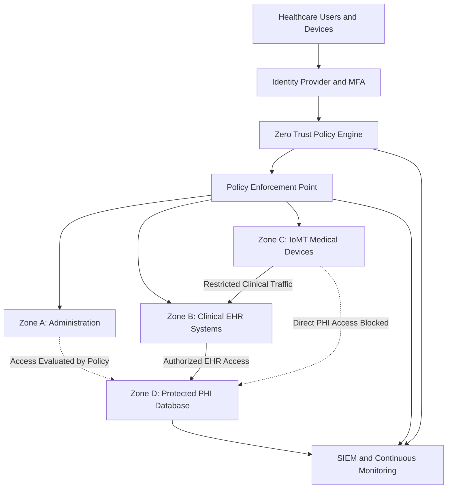

# Healthcare Zero Trust Micro-Segmentation Architecture

This reference architecture illustrates how Zero Trust principles can protect healthcare systems, clinical applications, and connected medical devices.

## Architecture Components

- **Identity Provider and MFA:** Verify users before allowing access.
- **Zero Trust Policy Engine:** Evaluate identity, device posture, and risk.
- **Policy Enforcement Point:** Enforce access decisions.
- **Network Segmentation:** Separate administrative, clinical, and medical-device networks.
- **Protected PHI Database:** Restrict sensitive patient data access.
- **SIEM Monitoring:** Collect security events for continuous detection and investigation.

**Note:** This is a conceptual reference architecture, not a production deployment.
